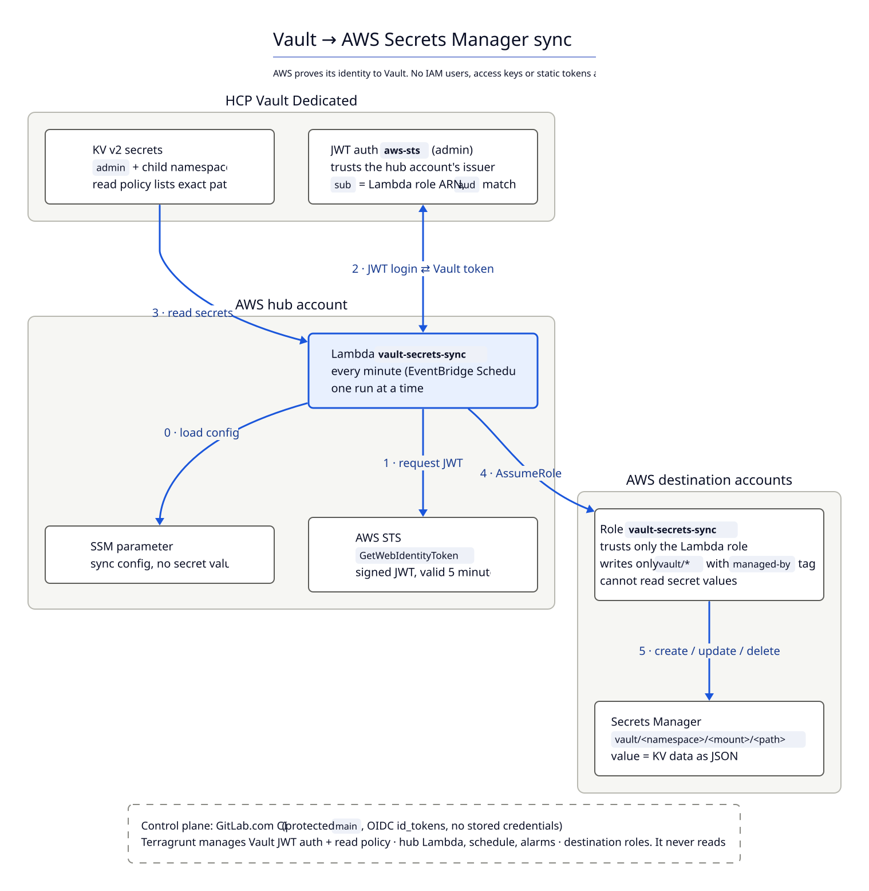

# vault-secrets-sync

Sync selected HCP Vault Dedicated KV v2 secrets, from `admin` and its child namespaces, into AWS Secrets Manager across several accounts. There are **no IAM users, access keys or static tokens** anywhere.

## Result



| Question | Answer |
| --- | --- |
| Can native Vault Secrets Sync run on HCP without an IAM user? | **No, not today.** HCP Vault Dedicated does not support WIF, including for Secrets Sync, and the `aws-sm` destination otherwise needs a static access key pair |
| Chosen mechanism | Scheduled Lambda: **AWS IAM outbound identity federation** (`sts:GetWebIdentityToken`) → **Vault JWT auth** → read KV v2 → **assumed role** writes Secrets Manager |
| Freshness | ≤ 1 minute (EventBridge Scheduler) |
| Granularity | secret-path: `vault/<namespace>/<mount>/<path>`, value = KV data as JSON |
| Vault clients billed | 1 for the Lambda (native Secrets Sync bills 1 per synced secret) |
| Secrets in Terraform state | None |
| TypeSafe assessment | Only passing option; weighted score 0.75 against 0.58 for native Secrets Sync (which fails two checks) |
| WIF | Revisit when HCP supports it; triggers and migration steps are in the ADR |

Details: [docs/adr-001-sync-mechanism.md](docs/adr-001-sync-mechanism.md) · Step-by-step: [docs/guide.md](docs/guide.md) · TypeSafe scores: [docs/assessment-results.md](docs/assessment-results.md)

## Quick start

```bash
# Tests and build (uv)
cd lambda && uv run pytest -q && cd ..
./scripts/build_lambda.sh                      # -> dist/vault-secrets-sync.zip

# Fill in CHANGE-ME values (live/common.hcl, account.hcl files, bootstrap/root.hcl, .gitlab-ci.yml),
# edit config/sync-targets.json, then: git init, push to GitLab.com, and follow docs/guide.md.

# Re-run the TypeSafe assessment with the updated constraints
export TYPESAFE_API_KEY=...
uv run assess_sync.py
```

## Layout

```text
config/sync-targets.json      what syncs where
lambda/                       sync code + tests (uv project)
scripts/build_lambda.sh       deterministic arm64 zip via uv
modules/                      sync-lambda, sync-target-role, vault-sync-reader,
                              gitlab-oidc-aws, vault-gitlab-jwt
live/                         Terragrunt units applied by GitLab CI
bootstrap/                    Terragrunt units an admin applies once (CI identities)
policies/                     SCP guardrail for synced secrets
docs/diagrams/                D2 sources + rendered SVGs (architecture, sync run)
.gitlab-ci.yml                test → build → plan (MR, read-only) → apply (main, approved)
assess_sync.py                TypeSafe assessment of candidate mechanisms
```

## How this was produced

One Claude Code session took this from question to repository: about 1 h 20 min (2026-10-04, 16:50–18:10 local) and 14 prompts. The token and tool counts below come from the session's local transcript and cover everything up to this section, so they leave out the turn that wrote it.

### Model and tokens

| Item | Value |
| --- | --- |
| Model | Claude Opus 5.5 (1M context) in Claude Code |
| Model calls | 125 |
| Output tokens (generated) | 177,319 |
| Input tokens, uncached | 248 |
| Input tokens, written to prompt cache | 374,213 |
| Input tokens, read from prompt cache | 27,063,764 |
| Total input processed | ~27.4 M |

Cache reads dominate because every call re-reads the whole conversation, and the cache serves that cheaply.

**TypeSafe API** (the user ran `assess_sync.py` in their own shell):

| Item | Value |
| --- | --- |
| Model | TypeSafe System One `jev-1.13.0` |
| Per run (measured, run 3) | 6 requests, 9,097 input + 858 output tokens |
| Runs | 3 (rubric v1, rubric v2, a v2 repeat that added the usage line) |
| Total, all runs | about 27,000 input + 2,600 output tokens. Only run 3 was measured; the earlier runs had very similar prompts, so the total is estimated at 3 × run 3 |

### Skills, connectors and tools

| Kind | Name | Used for |
| --- | --- | --- |
| Skill | `typesafe:typesafe-ai` | Framing the mechanism choice as typed judgments: Noul pass/fail checks, Score dimensions and a weighted composite in `assess_sync.py`, checked against the live TypeSafe docs and the installed SDK's types |
| Skill | `anthropic-skills:docs` | Writing and revising the shared Claude Doc version of the guide |
| Connector | Claude Docs (MCP) | 39 calls: create, fill and rewrite the doc, comments, diagram embeds |
| Connector | Artifact | Opening the doc; uploading the D2 SVGs to it |
| CLI | uv 0.10 | Running `assess_sync.py`, the Lambda tests (`pytest`), the lock file and the deterministic Lambda build |
| CLI | Terraform 1.12 | `fmt` and `validate` on all five modules; rendering the multi-namespace policy with `terraform console` |
| CLI | D2 0.9 | Architecture and sequence diagrams (`docs/diagrams/`) |
| Research | WebSearch ×9, WebFetch ×13, plus `curl` | HashiCorp, AWS and TypeSafe docs, provider docs and changelogs on GitHub, HCP changelog, botocore service model |

Tool calls: Bash 55, Write 23, Edit 10, Read 11, Claude Docs 39, WebFetch 13, WebSearch 9, ToolSearch 3, Skill 2, Artifact 2.

### What the effort went into

| Phase | Outcome |
| --- | --- |
| Assessment (TypeSafe) | Six mechanisms, three pass/fail checks, five scored dimensions. Native Secrets Sync won the first pass, before the no-IAM-user constraint |
| Design pivot | Research showed HCP Vault Dedicated blocks WIF, so native sync would need an IAM user key. Replaced it with AWS IAM outbound identity federation to Vault JWT auth |
| Build | Lambda (317 lines, 8 unit tests), 5 Terraform modules (970 lines), Terragrunt live and bootstrap trees (381 lines), GitLab CI, SCP |
| Rubric v2 | Removed double-counting of custom code; the Lambda's score rose from 0.57 to 0.75 with the same recommendation ([results](docs/assessment-results.md)) |
| Docs and diagrams | Step-by-step guide, ADR, Claude Doc; D2 diagrams after about 8 layout attempts (ELK left-to-right, grid, several ELK top-down variants that kept an edge crossing, then dagre) |

**Verified in the session:** Lambda tests pass, the build is byte-for-byte reproducible, every Terraform module validates, the policy renders correctly, and `.gitlab-ci.yml` parses.

**Not verified:** Terragrunt wasn't installed, so the `.hcl` units are unchecked. Nothing was deployed. Whether HCP Vault can reach the AWS token issuer is still an open item ([guide, step 7](docs/guide.md)).
