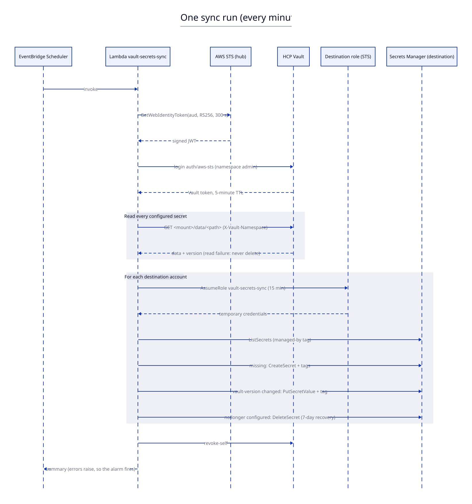

# Vault to AWS Secrets Manager sync: requirements and step-by-step guide

As of 2026-10-04. Design rationale: [ADR-001](adr-001-sync-mechanism.md).

## How it works




Diagram sources are `diagrams/*.d2`. Re-render after editing with `d2 docs/diagrams/architecture.d2 docs/diagrams/architecture.svg` (and the same for `sync-run`).

Each run reads every configured secret. A secret is created if it's missing, and updated only when its Vault version differs from the `vault-version` tag. It is deleted, with a 7-day recovery window, once it's removed from the config or from Vault. A secret whose Vault read fails is never deleted.

## Requirements

### Platform

| # | Requirement | Status |
| --- | --- | --- |
| P1 | HCP Vault Dedicated, Standard tier (Secrets Sync not used, so any tier works) | Confirmed |
| P2 | Source secrets in KV v2 mounts in `admin` or its child namespaces | Confirmed |
| P3 | AWS Organizations with a hub (security) account and destination accounts | Assumed |
| P4 | IAM outbound identity federation enabled in the hub account (Terraform does this) | Step 3 |
| P5 | One Vault client billed for the Lambda (plus one for CI) | |

### Tooling

| # | Requirement | Version |
| --- | --- | --- |
| T1 | Terraform | ≥ 1.10, < 2.0 (S3 native locking, cross-variable validation) |
| T2 | Terragrunt | ≥ 1.0 (`root.hcl`, `terragrunt run --all`, `terragrunt hcl fmt`) |
| T3 | Providers | `hashicorp/aws ~> 6.0` (outbound federation resource), `hashicorp/vault ~> 5.12` |
| T4 | uv | ≥ 0.10 (tests and Lambda build) |
| T5 | GitLab.com, Premium or Ultimate | Protected environments with deployment approvals |
| T6 | Lambda runtime | python3.13 on arm64, with boto3 bundled (≥ 1.42 has `get_web_identity_token`) |

### Identity, with no stored credentials

| # | Who | Authenticates to | How |
| --- | --- | --- | --- |
| I1 | Sync Lambda | Vault | `sts:GetWebIdentityToken` gives a JWT; Vault JWT auth `aws-sts` binds `sub` = Lambda role ARN and `aud` |
| I2 | Sync Lambda | Destination accounts | `sts:AssumeRole` into `vault-secrets-sync`, which trusts only the Lambda role |
| I3 | GitLab CI | AWS | id_token (`aud=sts.amazonaws.com`) assumes `gitlab-vault-secrets-sync-plan` (any branch) or `-apply` (protected `main`) |
| I4 | GitLab CI | Vault | id_token (`aud=<vault_addr>`) logs in to JWT auth `gitlab-jwt` with role `vault-secrets-sync-plan` or `-apply` |
| I5 | Admin, one time | AWS and Vault | Their own SSO profile and an HCP admin token, for `bootstrap/` only |

### Network

| # | Requirement |
| --- | --- |
| N1 | The Lambda reaches the Vault API on 8200: through HVN peering or Transit Gateway (set `subnet_ids`), or a NAT with a fixed EIP on the cluster's `ip_allowlist` |
| N2 | A self-managed GitLab runner tagged `vault-network` reaches the Vault API the same way. GitLab.com shared runners have no stable IPs |
| N3 | HCP Vault reaches `https://<id>.tokens.sts.global.api.aws/.well-known/{openid-configuration,jwks.json}` over the internet. Verify this in step 7 |
| N4 | The Lambda reaches the regional STS and Secrets Manager endpoints (NAT or VPC endpoints) |

### Security

- Terraform state contains no secret values or credentials: only ARNs, the issuer URL, policies and the sync config. State is still encrypted with SSE-KMS and locked to the CI roles.
- The destination role cannot call `GetSecretValue`. It can create only `vault/*` secrets carrying `managed-by=vault-secrets-sync`, and modify only secrets with that tag.
- The Vault read policy is generated from the config and lists exact paths, so there are no wildcards.
- Merge request pipelines use read-only AWS and Vault roles. Only protected `main` applies, after approval.
- `policies/scp-protect-synced-secrets.json` stops anyone except the sync role from editing synced secrets.

### Naming and format

- AWS secret name: `vault/<namespace>/<mount>/<path>`, for example `vault/admin/team-a/kv/api/stripe`.
- The value is the KV data as a JSON object (secret-path granularity).
- Tags: `managed-by`, `vault-namespace`, `vault-mount`, `vault-path`, `vault-version`.

## Step-by-step

### 1. Fill in placeholders (about 15 minutes)

Search for `CHANGE-ME` and the example account IDs (`111111111111`, `222222222222`, `333333333333`), then edit:

- `live/common.hcl`: state bucket and KMS key, `vault_addr`, hub account and region.
- `live/aws/*/account.hcl` and `bootstrap/aws/*/account.hcl`: account IDs and local AWS CLI profile names.
- `bootstrap/root.hcl`: GitLab.com `project_path`.
- `.gitlab-ci.yml`: `TG_IMAGE`, and the `aud` of `TERRAFORM_VAULT_AUTH_JWT`, which must equal `vault_addr`.
- `config/sync-targets.json`: real destinations and secrets.

Then run `git init` (Terragrunt uses `get_repo_root()`) and push to GitLab.com.

### 2. Create the state bucket (one time, admin)

S3 bucket with versioning, SSE-KMS (the key in `common.hcl`), public access blocked, and a bucket policy that allows only the admin role and the `gitlab-vault-secrets-sync-*` roles.

### 3. Bootstrap CI identities (one time, admin)

```bash
aws sso login --profile security-admin   # and prod-admin, nonprod-admin
export VAULT_TOKEN=<admin token from the HCP portal>
cd bootstrap
terragrunt run --all plan
terragrunt run --all apply
```

This creates the GitLab.com OIDC provider and the plan/apply roles in each account, plus the `gitlab-jwt` auth mount and its two roles and policies in Vault.

### 4. Seed a canary secret

```bash
vault kv put -namespace=admin -mount=app-kv sync-canary/ping value=hello
```

### 5. Open a merge request

CI runs `test:lambda` (pytest under uv), `test:terraform-fmt`, `build:lambda` (a deterministic zip) and `plan:mr`. The last one uses read-only roles, so it is safe on any branch. Review the plan, especially the rendered Vault policy (`policy` output of `sync-reader`).

### 6. Merge and approve the apply

`plan:main` runs, then `apply` waits for approval on the `vault-secrets-sync-prod` environment. Terragrunt applies in dependency order:

1. `aws/security/us-east-1/sync-lambda`: outbound federation, Lambda, schedule, config parameter, alarms.
2. `aws/prod/global/sync-target-role` and `aws/nonprod/global/sync-target-role`.
3. `vault/admin/sync-reader`: JWT auth mount `aws-sts`, role, read policy.

The Lambda may log a few failed runs between steps 1 and 3. To avoid that, set `schedule_enabled = false` for the first apply and flip it afterwards.

### 7. Verify

```bash
# Lambda ran cleanly (hub account)
aws logs tail /aws/lambda/vault-secrets-sync --since 10m --profile security-admin

# Manual run, no changes
aws lambda invoke --function-name vault-secrets-sync \
  --payload '{"dry_run": true}' --cli-binary-format raw-in-base64-out out.json && cat out.json

# Canary arrived (destination account; read with an admin role, not the sync role)
aws secretsmanager get-secret-value --secret-id vault/admin/app-kv/sync-canary/ping \
  --query SecretString --output text --profile prod-admin

# Change it; within ~60 s the AWS copy follows and the vault-version tag increments
vault kv put -namespace=admin -mount=app-kv sync-canary/ping value=world
```

If the Vault login fails with a JWKS or discovery error, HCP cannot reach the AWS issuer (N3). Open an HCP support case.

### 8. Apply the guardrail

Attach `policies/scp-protect-synced-secrets.json` as an SCP to the destination accounts' OU.

## Day-2 operations

| Task | How |
| --- | --- |
| Sync a new secret | MR adding its path to `config/sync-targets.json`. The plan shows the new Vault policy path and the SSM config change |
| Add a namespace | Add a source with `"namespace": "admin/<child>"`. The policy reaches child namespaces by prefix |
| Add a destination account | Add it under `destinations`, copy a `live/aws/<env>/global/sync-target-role` unit and a `bootstrap/aws/<env>` unit, then run bootstrap for that account |
| Stop syncing a secret | Remove it from the config. The AWS copy goes into a 7-day recovery window |
| Pause everything | `schedule_enabled = false` |
| Alerts | `vault-secrets-sync-errors` (3 failures in 5 min) and `vault-secrets-sync-not-running`. Set `alarm_sns_topic_arn` |
| Credential rotation | None needed: every credential is short-lived and federated |

## Repository map

| Path | Purpose |
| --- | --- |
| `config/sync-targets.json` | What syncs where (the only file most changes touch) |
| `lambda/` | Sync code (`src/vault_secrets_sync/handler.py`) and tests, managed by uv |
| `scripts/build_lambda.sh` | Builds `dist/vault-secrets-sync.zip` for arm64 with uv |
| `modules/sync-lambda` | Hub account: outbound federation, Lambda, schedule, config, alarms |
| `modules/sync-target-role` | Destination accounts: the write-only, tag-scoped role |
| `modules/vault-sync-reader` | Vault: JWT auth trusting AWS, role, generated read policy |
| `modules/gitlab-oidc-aws`, `modules/vault-gitlab-jwt` | CI identities (bootstrap) |
| `live/` | Terragrunt units CI applies |
| `bootstrap/` | Terragrunt units an admin applies once |
| `policies/scp-protect-synced-secrets.json` | Org guardrail |
| `assess_sync.py` | TypeSafe assessment of the candidate mechanisms |
